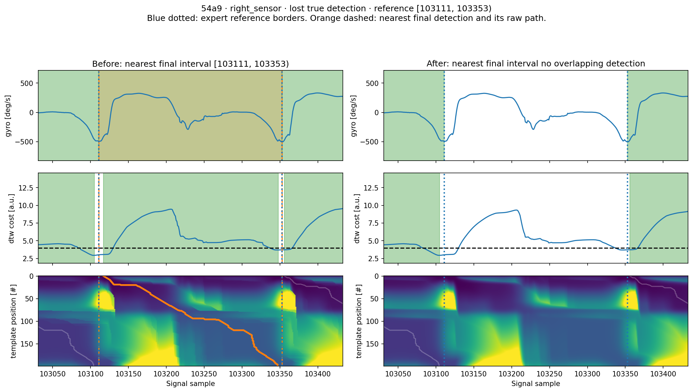

.. _constrained_dtw_benchmark:

Constrained DTW: labeled stride-segmentation benchmark
========================================================

The :ref:`issue 93 example comparison <constrained_dtw_issue_93>` establishes numerical correctness and shows changed
stride borders. It provides little evidence about detection accuracy. This benchmark compares the old and corrected
algorithms against expert labels using the existing ``gaitmap-bench`` Sensor Position Comparison instep challenge.

Protocol and reproducibility
------------------------------

The challenge uses all 14 participants in Sensor Position Comparison 2019, both instep sensors at 204.8 Hz, and each
complete recording. These contain walking tests at different speeds, turns, movement between tests, and marker jumps.
The expert reference labels cover the full recordings. A true detection must match both reference borders within
30 ms, truncated by the challenge to six samples, with one-to-one matching. This is a healthy-participant dataset.
It does not establish results in patient cohorts.

Both algorithms use unchanged ``ConstrainedBarthDtw()`` defaults: the original three-axis gyroscope template,
120 ms horizontal and vertical limits, maximum cost 4, and the same duration, snapping and conflict filters. No parameters
are fitted or selected using these labels. Fixed defaults need no training, so each participant is evaluated once;
the standard five KFold test partitions are then aggregated from those same predictions. The runner calls the
challenge's ``final_scorer`` for matching and metrics, retaining its raw matching tables. A compatibility adapter
returns those tables directly instead of constructing the historical tpcp aggregator class with the newer API.

The baseline is gaitmap commit ``7c521a49d4e856ed2f0241532d351a5208a14bce``. It already contains the initialization
correction from issue 76. This comparison measures the separate state-tracking and traceback correction from issue 93.
The benchmark source is ``gaitmap-bench`` commit ``50b8d08584ca50f7d10c539d4070978f40e62214``, challenge version 1.0.0.
The dataset loader is ``gaitmap-datasets`` 0.15.0, source commit ``d76ab360d1b936b33c41eabd64e0906911cccf3d``.

From a gaitmap checkout, with gaitmap-datasets installed and a local gaitmap-bench checkout:

.. code-block:: bash

   MPLBACKEND=Agg .venv/bin/python scripts/benchmark_constrained_dtw.py \
       --bench-repo /path/to/gaitmap-bench \
       --dataset-path /path/to/sensorpositoncomparison

Results and matching tables are written to ``work/issue-93/benchmark``. The summary records the exact source revisions,
package versions, participant order, parameters, tolerance, and reference-file SHA256 hashes. The before calculation
is compiled directly from the baseline git revision. The checked-out gaitmap code supplies the after calculation.

Benchmark entry foot-selection bug
------------------------------------

The historical entry maps raw sensor names to ``left_sensor`` and ``right_sensor``, then calls
``convert_to_fbf(..., left_like="l", right_like="r")``. The right substring also occurs in ``left_sensor`` through
``sensor``. The right-foot conversion therefore overwrites the left-foot conversion. For participant ``4d91``, the
old algorithm gets only 8 of 416 left reference strides with this mapping, versus 400 with the correct mapping.

The primary results use explicit ``left=["left_sensor"]`` and ``right=["right_sensor"]`` for both algorithms.
The historical entry mapping is replayed separately on the same 14 participants as a diagnostic control. Its scores
must not be mixed into the primary comparison. This adapter correction does not change gaitmap's coordinate conversion
or the benchmark repository.

Results
---------

With explicit foot mapping, there are 12,171 reference strides across 14 participants and 28 sensor recordings.
The corrected algorithm has a small detection regression with the unchanged default parameters.

.. list-table:: Pooled counts and metrics, explicit foot mapping
   :header-rows: 1

   * - Metric
     - Before
     - After
   * - True positives
     - 10,406
     - 10,394
   * - False positives
     - 38
     - 38
   * - False negatives
     - 1,765
     - 1,777
   * - Precision
     - 99.6362%
     - 99.6357%
   * - Recall
     - 85.4983%
     - 85.3997%
   * - F1
     - 92.0274%
     - 91.9701%
   * - Illegal returned paths
     - 464
     - 0
   * - Path/reported-cost disagreements
     - 464
     - 0

F1 changes by -0.0573 percentage points. The participant-paired bootstrap 95% percentile interval is
[-0.1006, -0.0203] percentage points. Participant-macro F1 changes from 91.6488% to 91.5937%; the mean of the five
pooled test-fold F1 scores changes from 91.9227% to 91.8660%. These aggregation methods answer different questions
and are recorded separately in the summary.

Reference-ID matching finds 12 lost true detections, no gained true detections, and no net change in false positives.
Six participants lose detections; eight have unchanged aggregate counts. Final interval sets change in nine of the
28 sensor recordings, including an exchange of false-positive intervals. All 10,432 new returned paths satisfy the
stretch limits and agree with their reported costs. Most repairs to illegal old paths leave the final detected
borders unchanged.

The historical entry mapping gives pooled F1 65.7673% before and 65.7229% after, compared with 92.0274% and 91.9701%
for explicit feet. Its low absolute score is dominated by the foot-selection bug and must not be attributed to the
issue 93 correction.

Recorded segmentation calls over the 14 recordings, both sensors, total approximately 57.1 s before and 67.2 s after.
These exclude data loading, frame conversion, scoring, and plotting. The recorded run warmed C/F array layouts but
used integer stretch arguments; the first legacy call therefore also specialized floating arguments. The runner now
warms the floating signature used by public parameter conversion. Accuracy scores are unaffected. These single-pass
timings have fixed execution order and startup effects and should not be interpreted as a controlled speed comparison.
The separate numerical-engine memory/runtime experiment remains available in the example comparison.

Download the :download:`summary and provenance <../../data/issue_93_benchmark/summary.json>`,
:download:`per-sensor metrics <../../data/issue_93_benchmark/per_sensor.csv>`, and
:download:`changed intervals and reference IDs <../../data/issue_93_benchmark/changes.json>`.
The runner also saves every raw matching table locally for audit.

Individual improved and worsened detections
---------------------------------------------

The runner selects the participant/sensor with the largest number of gained reference detections, and separately the
one with the largest number of lost reference detections. It shows the first reference ID in each selected case.
This selection explains concrete changes; it does not represent the average recording. Blue dotted lines show expert
reference borders. Orange dashed lines show the closest overlapping final detected interval and its associated raw
path. Green shading in the top panel shows final detections; shading in the cost panel shows raw intervals.

No true detections were gained, so there is no improved true-detection case to display. The selected loss is from
participant ``54a9``, right sensor, reference ``[103111, 103353)``. The old final interval matches the expert borders;
the new result has no retained overlapping detection. The small change in the cost curve does not make that loss
visually obvious without the reference borders and final detection shading.

Interpretation
----------------

A minimum-cost constrained alignment is a mathematical objective. Detection accuracy also depends on the template,
threshold, peak selection and postprocessing. A numerically better alignment can select a shorter part of a stride
and then fail duration filtering, or move a selected minimum away from a labeled endpoint. Therefore a legality and
optimality repair does not imply a higher F1 score with parameters calibrated for the old behavior.

This experiment holds those parameters fixed to isolate the practical effect of the fix. It does not test whether
retuning the corrected algorithm can improve results. Such a comparison would require nested validation with fitting
confined to training participants for each algorithm. The statistical unit here is a participant; the reported paired
bootstrap interval resamples the 14 participants 2,000 times with seed 93. It is descriptive uncertainty for this
cohort, not an independent replication or evidence across clinical populations.
