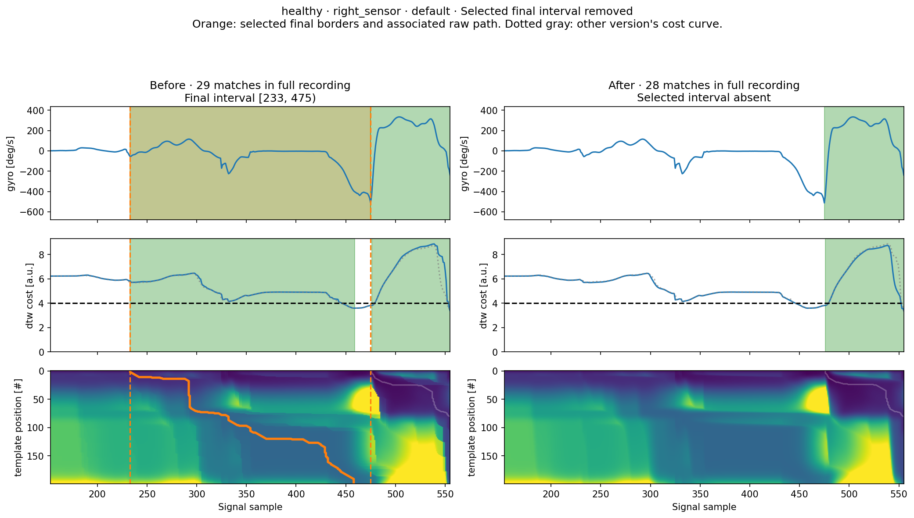
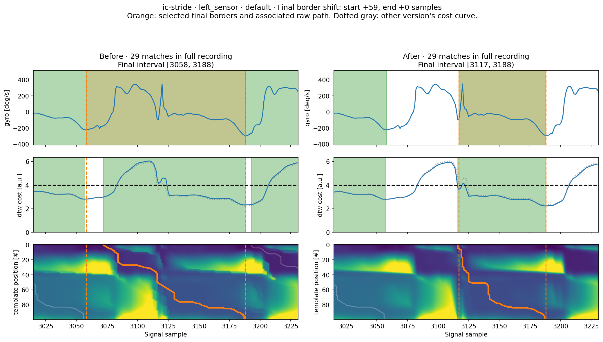
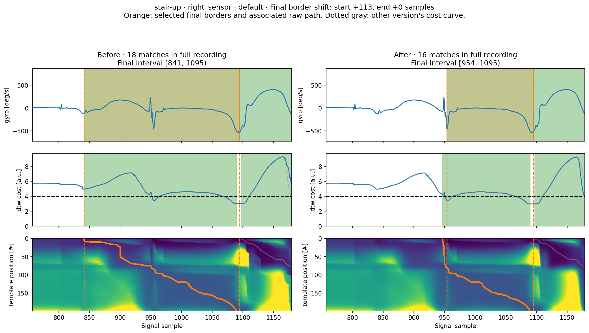

.. _constrained_dtw_issue_93:

Constrained DTW correction: example-data comparison
=====================================================

`Issue 93 <https://github.com/mad-lab-fau/gaitmap/issues/93>`_ identified two independent failures:
the forward pass discarded arrivals with different stretch allowances, and ordinary traceback could traverse edges
forbidden by the constrained calculation. The corrected calculation keeps the cheapest cost for each arrival
direction/run length and follows its selected predecessors. Ties select one path deterministically, in diagonal,
vertical, horizontal order, with shorter bounded runs first. Match starts consume no stretch allowance.

The public parameters and result formats are unchanged. The unconstrained calculation and traceback are unchanged.
Constrained peak selection preserves the original distance-filtered interior minima and additionally considers
recording-boundary minima. New boundary candidates pass postprocessing before they can suppress existing matches. A limit of L consecutive steps permits L + 1
matched samples in that run. Duration filtering, border snapping, and conflict resolution remain separate from the
minimum-cost path calculation; this change does not optimize detection quality against a clinical reference.

Reproduce the comparison
--------------------------

From the repository root, run:

.. code-block:: bash

   MPLBACKEND=Agg uv run python scripts/compare_constrained_dtw.py
   MPLBACKEND=Agg uv run python scripts/compare_constrained_dtw.py --benchmark-only

The optional process RSS benchmark requires Linux or macOS; ordinary comparisons also support Windows.

The default baseline is commit ``7c521a49d4e856ed2f0241532d351a5208a14bce``, before the issue 93 correction.
The command compiles that revision's numerical function and selects the existing legacy cost-only/traceback branch;
the working tree is not changed. Historical replay was checked against results captured before editing, including
the entire accumulated matrices, returned paths, and snapped intervals. Both versions use the same input data,
coordinate conversion, template columns ``gyr_ml``/``gyr_si``, parameters, and postprocessing rules. Constrained
peak selection differs only in the handling of recording boundaries described above.

Outputs are written to ``work/issue-93/comparison``: ``summary.csv``, per-path ``details.json``, and paired plots for
cases with changed final stride borders after all postprocessing. Plots reuse ``plot_dtw`` from the constrained Barth tutorial, showing the signal,
endpoint cost function, accumulated cost matrix, and paths. Plot windows share axes limits and matrix color scales.
Green shading in the signal panel shows final detected intervals; the cost panel shows raw intervals before snapping.
Orange dashed lines mark the selected final borders, with their associated raw path in orange. Each cost panel overlays
the other version's curve in dotted gray. Counts in plot titles refer to the full recording.

Observed changes
------------------

Results with default ``ConstrainedBarthDtw`` constraints/postprocessing, using the tutorial's two-column template
``gyr_ml``/``gyr_si`` rather than all three gyroscope axes. Both stretch limits are 120 ms:

.. list-table:: Detected intervals, before to after
   :header-rows: 1

   * - Recording
     - Left sensor
     - Right sensor
     - Old illegal paths, both sensors
   * - Healthy, 204.8 Hz
     - 28 to 28
     - 29 to 28
     - 3
   * - MS, 102.4 Hz
     - 74 to 74
     - 73 to 73
     - 2
   * - IC-stride, 102.4 Hz
     - 29 to 29
     - 29 to 29
     - 18
   * - Stair ascent, 204.8 Hz
     - 18 to 17
     - 18 to 16
     - 3
   * - Stair descent, 204.8 Hz
     - 5 to 4
     - 4 to 4
     - 2

Healthy left and both MS default snapped stride borders are identical before and after, despite changes to paths and
costs. Healthy right loses one interval. Stair-ascent left loses one interval; the right loses two and shifts two
existing starts. IC-stride left shifts two existing starts; its right sensor is unchanged. Stair-descent left loses
one interval. The earlier broad peak-selection experiment that produced ten additional stair-descent detections is
not part of this fix. Keeping the original interior peak selection avoids attributing that behavior to the DP repair.

Two additional MS comparisons reproduce the tutorial's vertical-only 110 ms and 120 ms settings with no minimum
duration filter. Match counts stay at 74 left and 76 right. Each changes one snapped right-sensor interval from
``[6077, 6079)`` to ``[6075, 6079)``. These very short intervals remain possible because that tutorial deliberately
disables the minimum-duration filter.

Across the 14 constrained sensor/configuration comparisons, 607 old and 602 new paths were returned. The old results
contained 37 stretch-limit violations and 37 path/reported-cost disagreements; the corrected results contained zero
of either. These totals include repeated MS recordings under different settings, not independent participants.
The four unconstrained healthy/MS sensor controls had identical accumulated matrices, paths, costs, and stride borders.
The complete comparison is available as :download:`summary.csv <../../images/issue_93/summary.csv>`.

Healthy: one false positive removed
~~~~~~~~~~~~~~~~~~~~~~~~~~~~~~~~~~~~~

The right sensor loses ``[233, 475)``. Against the supplied hand-labeled healthy stride borders, exact border matching
with ``evaluate_segmented_stride_list`` gives 28 true positives, 1 false positive, and 2 false negatives before;
afterwards it gives 28 true positives, 0 false positives, and 2 false negatives. Left-sensor results stay at 28 true
positives with no false positives or false negatives. Thus this recording provides a small, measured detection
improvement. It does not establish improved precision or recall on other recordings.

IC-stride: shifted final starts
~~~~~~~~~~~~~~~~~~~~~~~~~~~~~~~~~

The left-sensor interval ``[3058, 3188)`` changes to ``[3117, 3188)``. Its start moves by 59 samples, approximately
576 ms at 102.4 Hz. Another interval changes from ``[3188, 3305)`` to ``[3239, 3305)``. These are substantial border
shifts even though the match count stays at 29 and much of the cost curve looks similar. The supplied IC reference
labels do not cover these changed intervals, so they cannot establish which borders are more accurate.

Stair ascent: shifted start and fewer detections
~~~~~~~~~~~~~~~~~~~~~~~~~~~~~~~~~~~~~~~~~~~~~~~~~~

The right-sensor interval ``[841, 1095)`` changes to ``[954, 1095)``, a 113-sample start shift, approximately 552 ms at
204.8 Hz. Another start shifts by 88 samples. Two intervals disappear, reducing the count from 18 to 16. No compatible
reference labels for these stair intervals are supplied by the comparison, so these changes are not scored as accuracy
improvements. All seven sensor/configuration cases with changed final borders are included in the generated gallery.

Memory and runtime
--------------------

State costs use two rolling columns. Only three predecessor state IDs per cell are stored; predecessors for runs
longer than one are implicit. Unbounded directions and finite limits that cannot bind collapse to one state.
The smallest unsigned integer type that fits the state IDs is selected.

For a 200-sample template, 20,000-sample signal, three features, and limits of 20 steps in both directions:

.. list-table:: Numerical-engine memory
   :header-rows: 1

   * - Representation
     - Memory
   * - Naive full float64 state costs alone
     - 1,312 MB
   * - Corrected retained matrix, traceback IDs, endpoint states
     - 44.02 MB
   * - Corrected rolling working buffers, approximately
     - 0.15 MB
   * - Measured old incremental peak RSS, including its cost-matrix copy
     - 96.3 MB
   * - Measured corrected incremental peak RSS
     - 44.1 MB

MB uses decimal units. Each engine ran in a separate warmed process. Incremental peak RSS excludes its measured
pre-call baseline and uses independent process sampling plus the process high-water mark. This numerical-engine
measurement excludes later path reconstruction and plotting. The old retained result is only the 32 MB cost matrix;
its higher peak comes from the temporary two-layer tensor and copy. Benchmark details are available as
:download:`benchmark.json <../../images/issue_93/benchmark.json>`.

One local warmed numerical calculation took approximately 0.17 s before and 0.22 s after. End-to-end medians of three
calls on the example recordings vary by dimensions and constraints: the corrected engine is faster on the MS
vertical-only cases and slower on the longer-template healthy/stair cases. Timings are descriptive local measurements,
not a performance guarantee. The memory layout removes the full state-cost tensor, but runtime still grows with the
number of bounded run states.

Validation and interpretation
-------------------------------

The numerical regression tests exercise ``BaseDtw.segment`` and compare every accumulated cell against independent
exhaustive valid-path enumeration on small inputs. They check the issue's zero-cost example, both match-selection
methods, path legality and costs, recording boundaries, ties, rounded-zero/unbounded/nonbinding limits, caching, and
state IDs wider than one byte. Existing Barth consumers and DTW tutorial snapshots also pass.

Analyses that use constrained DTW should expect changed paths, costs, and potentially stride borders. Identical final
borders do not imply identical alignments. Existing scientific conclusions may need reassessment when the changed
recordings/settings are relevant; the healthy-label result above is limited evidence, and general improvements in clinical precision or recall remain unproven.
